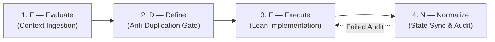

# E.D.E.N. Protocol
### Agent Operating System & Sovereign Engineering Harness
**Necessity Labs · Local-First · Zero-Bloat · Provider-Agnostic**

```
   ███████╗    ██████╗     ███████╗    ███╗   ██╗
   ██╔════╝    ██╔══██╗    ██╔════╝    ████╗  ██║
   █████╗      ██║  ██║    █████╗      ██╔██╗ ██║
   ██╔══╝      ██║  ██║    ██╔══╝      ██║╚██╗██║
   ███████╗    ██████╔╝    ███████╗    ██║ ╚████║
   ╚══════╝    ╚═════╝     ╚══════╝    ╚═╝  ╚═══╝
```

---

## 1. What is E.D.E.N.?

Modern autonomous AI coding agents (Claude Code, Cursor, GitHub Copilot, Gemini CLI / Antigravity, Windsurf, Aider) are extraordinarily capable, but when left unconstrained across multi-turn sessions they suffer from predictable failure modes:

1. **Cognitive Drift & Amnesia:** Agents forget previous architectural decisions, reinvent existing helpers, and introduce conflicting conventions.
2. **Utility Duplication:** Agents generate duplicate HTTP clients, file readers, string formatters, or database wrappers rather than discovering existing codebase primitives.
3. **Hardware & Ceiling Ignorance:** Cloud-trained models write code that assumes infinite RAM and unconstrained CPU, triggering Out-Of-Memory (OOM) crashes and thermal throttling on edge devices.
4. **Documentation Rot:** Agents modify business logic and source files while abandoning documentation, breaking handoffs to future sessions and human collaborators.

Passive prompt instructions fail to prevent this because prompts degrade as context windows fill.

The **E.D.E.N. Protocol** turns passive instructions into an **active, state-driven filesystem harness**. Built on plain Markdown, JSONL, and zero-dependency audit scripts, E.D.E.N. forces agents through a strict 4-phase execution loop that mechanically prevents drift and duplication.

---

## 2. The Law of Necessity

Every AI agent operating in an E.D.E.N.-governed repository must adhere strictly to the **Law of Necessity**:

* **E — Everything is broken:** Assume zero-trust defaults. Rely on local sovereignty and pure primitives rather than fragile cloud dependencies or bloated abstractions.
* **D — Define the mechanics:** Understand raw memory, I/O, native bindings, process limits, and hardware ceilings before touching code.
* **E — Engineer the architecture:** Build modular, decoupled, unidirectional systems with explicit seams.
* **N — Necessity dictates the output:** Zero dead code, zero duplicate utilities, zero unapproved packages.

---

## 3. The 4-Phase E.D.E.N. Execution Loop

Agents are barred from writing or modifying source code until Phases 1 and 2 are satisfied, and tasks are marked incomplete until Phase 4 passes compliance checks.



### Phase 1: E — Evaluate (Context Ingestion)
Before proposing or writing any code, the agent ingests the project control plane:
1. `.eden/ARCHITECTURE.md` — Hardware ceilings, system boundaries, memory limits, and data flows.
2. `.eden/REGISTRY.md` — Complete index of existing modules, APIs, and approved dependencies.
3. `.eden/LEARNINGS.md` — Documented environment quirks, edge cases, and resolved pitfalls.
4. `tail -n 10 .eden/CHANGELOG_AGENT.jsonl` — Recent mutations for immediate context.

### Phase 2: D — Define (The Anti-Duplication Gate)
1. Check `.eden/PLAN.md` for active sprint scope and task criteria.
2. **Anti-Duplication Shield:** Query `.eden/REGISTRY.md` before creating any function, class, or utility. If an equivalent or overlapping component exists, the agent **must** reuse or extend it.
3. Formulate an execution plan explicitly listing the files to be modified and existing registry modules being reused.

### Phase 3: E — Execute (Lean Implementation)
1. Implement the solution adhering to the hardware constraints defined in `.eden/ARCHITECTURE.md`.
2. Adhere to single-responsibility and clean architectural boundaries.
3. Strip unused imports, dead code, and placeholders immediately.

### Phase 4: N — Normalize (State Synchronization & Audit Gate)
The task is **incomplete** until repository state is synchronized:
1. **Update `.eden/REGISTRY.md`:** Index every new or modified module, API, and approved dependency.
2. **Append to `.eden/CHANGELOG_AGENT.jsonl`:** Append a single-line JSON audit record.
3. **Update `.eden/LEARNINGS.md`:** Record any resolved non-obvious bug or runtime trap.
4. **Update `.eden/PLAN.md`:** Mark completed criteria and update active backlog.
5. **Run Compliance Audit:** Execute `python scripts/eden-audit.py`. If the audit fails (exit code `1`), the agent must remediate before returning control.

---

## 4. Repository Structure

```text
my-project/
├── AGENTS.md                  # Master Agent Operating System & Architecture Rules
├── CLAUDE.md                  # Universal Forwarder Trampoline -> AGENTS.md
├── .cursorrules               # Universal Forwarder Trampoline -> AGENTS.md
├── .cursor/rules/eden.mdc     # Cursor Rules Trampoline
├── .windsurfrules             # Universal Forwarder Trampoline -> AGENTS.md
├── .github/
│   └── copilot-instructions.md# Copilot Trampoline -> AGENTS.md
├── GEMINI.md                  # Gemini / Antigravity Trampoline -> AGENTS.md
├── .eden/
│   ├── ARCHITECTURE.md        # Hardware ceilings, memory budgets, runtime specs
│   ├── REGISTRY.md            # Anti-Duplication Component & Dependency Map
│   ├── PLAN.md                # Active sprint backlog & task acceptance criteria
│   ├── LEARNINGS.md           # Episodic memory of bugs, pitfalls, and fixes
│   └── CHANGELOG_AGENT.jsonl  # Append-only machine-readable mutation history
├── scripts/
│   ├── eden-audit.py          # Zero-dependency compliance auditor
│   └── eden-index.py          # Zero-dependency AST/regex component indexer
└── docs/                      # Human & project documentation
```

---

## 5. Quickstart

### Bootstrapping a Repository
To scaffold the E.D.E.N. Protocol into any new or existing repository:

**Linux / macOS / Termux / PRoot / WSL:**
```bash
./init-eden.sh
```

**Windows PowerShell:**
```powershell
.\init-eden.ps1
```

The bootstrapper:
1. Scaffolds `.eden/` and `.eden/CHANGELOG_AGENT.jsonl`.
2. Generates the master `AGENTS.md` operating system.
3. Generates universal forwarder trampolines for Claude Code, Cursor, Copilot, Gemini/Antigravity, and Windsurf.
4. Installs the Git `.git/hooks/pre-commit` enforcement hook.
5. Runs `eden-index.py` to auto-index existing source files.

### Verifying Compliance
Run the compliance auditor at any time:
```bash
python scripts/eden-audit.py
```

---

## 6. Documentation Suite

* [**Protocol Specification**](docs/SPECIFICATION.md) — Complete specification of the `.eden/` control plane, JSONL schemas, and lifecycle rules.
* [**Multi-Agent Routing**](docs/MULTI_AGENT_ROUTING.md) — How forwarder trampolines ensure zero-drift execution across Claude, Cursor, Copilot, Gemini, and Windsurf.
* [**CLI & Compliance Auditing**](docs/CLI_AND_AUDITING.md) — Reference for `eden-audit.py`, `eden-index.py`, Git hooks, and CI/CD integration.
* [**Migration & Retrofit Guide**](docs/MIGRATION_GUIDE.md) — How to clean up existing doc sprawl and migrate legacy codebases to E.D.E.N.

---

## 7. License

Licensed under the MIT License. Built with sovereign discipline by **Necessity Labs**.
