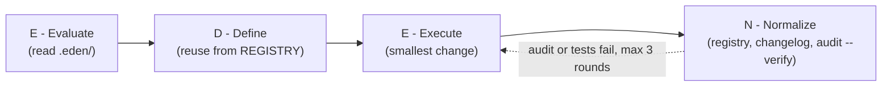

# E.D.E.N. Protocol
### Agent Operating System & Sovereign Engineering Harness
**Necessity Labs · Local-First · Zero-Bloat · Provider-Agnostic**

```
   ███████╗    ██████╗     ███████╗    ███╗   ██╗
   ██╔════╝    ██╔══██╗    ██╔════╝    ████╗  ██║
   █████╗      ██║  ██║    █████╗      ██╔██╗ ██║
   ██╔══╝      ██║  ██║    ██╔══╝      ██║╚██╗██║
   ███████╗    ██████╔╝    ███████╗    ██║ ╚████║
   ╚══════╝    ╚═════╝     ╚══════╝    ╚═╝  ╚═══╝
```

---

## 1. What is E.D.E.N.?

Modern autonomous AI coding agents (Claude Code, Cursor, GitHub Copilot, Gemini CLI / Antigravity, Windsurf, Aider) are extraordinarily capable, but when left unconstrained across multi-turn sessions they suffer from predictable failure modes:

1. **Cognitive Drift & Amnesia:** Agents forget previous architectural decisions, reinvent existing helpers, and introduce conflicting conventions.
2. **Utility Duplication:** Agents generate duplicate HTTP clients, file readers, string formatters, or database wrappers rather than discovering existing codebase primitives.
3. **Hardware & Ceiling Ignorance:** Cloud-trained models write code that assumes infinite RAM and unconstrained CPU, triggering Out-Of-Memory (OOM) crashes and thermal throttling on edge devices.
4. **Documentation Rot:** Agents modify business logic and source files while abandoning documentation, breaking handoffs to future sessions and human collaborators.

Passive prompt instructions fail to prevent this because prompts degrade as context windows fill.

The **E.D.E.N. Protocol** turns passive instructions into an **active, state-driven filesystem harness**. Built on plain Markdown, JSONL, and zero-dependency audit scripts, E.D.E.N. routes agents through a lane-based execution loop that mechanically prevents drift and duplication.

---

## 2. The Law of Necessity

Every AI agent operating in an E.D.E.N.-governed repository must adhere strictly to the **Law of Necessity**:

* **E — Everything is broken:** Assume zero-trust defaults. Rely on local sovereignty and pure primitives rather than fragile cloud dependencies or bloated abstractions.
* **D — Define the mechanics:** Understand raw memory, I/O, native bindings, process limits, and hardware ceilings before touching code.
* **E — Engineer the architecture:** Build modular, decoupled, unidirectional systems with explicit seams.
* **N — Necessity dictates the output:** Zero dead code, zero duplicate utilities, zero unapproved packages.

---

## 3. The E.D.E.N. Execution Loop

`AGENTS.md` is short decision rules, not ceremony. Agents first pick a lane:

| Lane | Examples | What runs |
| :--- | :--- | :--- |
| Read-only | questions, reviews | read and answer; no Normalize |
| Trivial | typo, comment, docs-only | change + audit |
| Normal | code change inside the current design | full loop |
| Architectural | new boundary, dependency, schema, deletion | Evaluate + Define, write plan, **wait for approval** |



1. **Evaluate:** read `.eden/ARCHITECTURE.md`, `.eden/REGISTRY.md`, `.eden/LEARNINGS.md`, and the last 10 lines of `.eden/CHANGELOG_AGENT.jsonl`.
2. **Define:** check `.eden/PLAN.md`; search the registry and reuse or extend before adding helpers or packages.
3. **Execute:** smallest change that meets the acceptance criteria.
4. **Normalize:** register changed source files, append a changelog line listing them, record verified learnings, update the plan, and run `python3 scripts/eden-audit.py --verify`.

**Done** = tests / `.eden/verify` pass + audit passes + acceptance criteria met. After 3 failed fix rounds the agent stops and reports to a human. `AGENTS.md` also defines what happens when a request conflicts with `PLAN.md`, and a short never-do list.

---

## 4. Repository Structure

```text
my-project/
├── AGENTS.md                  # The rules every agent reads (or an EDEN block inside your own AGENTS.md)
├── GEMINI.md                  # Antigravity / Gemini pointer -> AGENTS.md
├── .cursor/
│   ├── rules/eden.mdc         # Cursor rule pointer -> AGENTS.md
│   └── hooks.json             # Stop hook for Cursor AND Grok Build
├── .github/
│   ├── copilot-instructions.md# Copilot pointer -> AGENTS.md
│   └── hooks/eden.json        # Stop hook for Copilot (CLI, cloud agent, VS Code)
├── .agents/
│   ├── hooks.json             # Stop hook for Antigravity
│   └── skills/                # eden-normalize, eden-architect, eden-adopt (shared Agent Skills)
├── .eden/
│   ├── ARCHITECTURE.md        # Runtime, limits, data flow, invariants
│   ├── REGISTRY.md            # Anti-Duplication Component & Dependency Map
│   ├── PLAN.md                # Active sprint backlog & task acceptance criteria
│   ├── LEARNINGS.md           # Episodic memory of bugs, pitfalls, and fixes
│   ├── CHANGELOG_AGENT.jsonl  # Append-only machine-readable mutation history
│   └── verify / verify.py     # Project lint + test commands run by audit --verify (generated on adopt)
└── scripts/
    ├── eden-audit.py          # Compliance auditor (--staged, --base, --verify, --doctor)
    ├── eden-index.py          # Component indexer for REGISTRY.md
    ├── eden-hook.py           # Stop hook: audits changed source before the agent may finish
    └── eden_common.py         # Shared extension and ignore lists
```

Opt-in extras: `CLAUDE.md` (`--tools ...,claude`, or merged automatically when you already have one) and the legacy `.cursorrules` / `.windsurfrules` (`--legacy`). The protocol repository itself also contains `templates/`, `scripts/eden-install.py` (the installer the init scripts call), and `tests/` (stdlib `unittest`).

---

## 5. Quickstart

### New project or existing project?

| Your repository | Run | What happens |
| :--- | :--- | :--- |
| Empty, or no commits yet | `init-eden.sh --new` | Full `AGENTS.md` and pointer files are written. Fill in Commands yourself, or add `--detect`. |
| Has code or history | `init-eden.sh --adopt` | Your `AGENTS.md`, `CLAUDE.md`, `GEMINI.md`, and `copilot-instructions.md` keep their text; E.D.E.N. adds an `<!-- EDEN:BEGIN v1 -->` ... `<!-- EDEN:END -->` block. Commands and `.eden/verify` are detected from `package.json`, `pyproject.toml`, `Cargo.toml`, `go.mod`, `gradlew`, or `Makefile`, and existing code is indexed into the registry. |
| Not sure | `init-eden.sh` | Picks `--new` when there are no commits and no source files, otherwise `--adopt`. |

Re-running is safe: up-to-date files are left alone, the EDEN block is updated in place, and the changelog only gets a line when something changed. `--force` replaces E.D.E.N.-managed files wholesale (backups as `<file>.eden-bak`); `.eden/` state is never replaced.

**Linux / macOS / Termux / WSL / Git Bash:**
```bash
/path/to/E.D.E.N-Protocol/init-eden.sh [--new|--adopt] [--tools antigravity,cursor,grok,vscode] [--legacy] [--force] [TARGET_DIR]
```

**Windows PowerShell** (GNU-style `--adopt` options work too):
```powershell
C:\path\to\E.D.E.N-Protocol\init-eden.ps1 [-New|-Adopt] [-Tools cursor,vscode] [-Legacy] [-Force] [TargetDir]
```

Both need Python 3 (found as `python3`, `python`, or `py -3`). `--tools` defaults to all four of `antigravity,cursor,grok,vscode`; add `claude` for a `CLAUDE.md`. If you use husky, lefthook, or pre-commit, the git hook is not installed; add `python3 scripts/eden-audit.py --staged` to that tool's pre-commit step. Set `EDEN_RAW_BASE` to a raw-file URL of this repository to download the files instead of using a local clone.

Afterwards, `python3 scripts/eden-audit.py --doctor` shows what each tool will load and what is still unfinished.

### Per-tool setup

Every tool reads `AGENTS.md`, uses the skills in `.agents/skills/`, and runs `scripts/eden-hook.py` when the agent tries to finish. The hook audits only when source files changed, and forces at most 2 extra rounds before letting the agent stop and report (matching the "3 rounds, then report" rule). Set `EDEN_HOOK_VERIFY=1` to also run `.eden/verify` in the hook, or `EDEN_HOOK_DISABLE=1` to turn it off.

* **Google Antigravity** - reads `AGENTS.md` and `GEMINI.md`, the skills in `.agents/skills/`, and the Stop hook in `.agents/hooks.json`. Open the repository root as the workspace.
* **Cursor** - reads `AGENTS.md` and `.cursor/rules/eden.mdc`; the stop hook is in `.cursor/hooks.json`. Check it under Settings > Hooks.
* **Grok Build** - reads `AGENTS.md`, `.agents/skills/`, and the hooks in `.cursor/hooks.json`. Project hooks only run in a trusted folder: start with `grok --trust` (or run `/hooks-trust` once), and use `grok inspect` to confirm the hook and skills loaded. Do not also add `.grok/hooks/` or `.claude/settings.json` hooks, or the audit runs twice (`--doctor` warns about this).
* **VS Code / GitHub Copilot** - reads `.github/copilot-instructions.md` and `AGENTS.md`; `.github/hooks/eden.json` serves Copilot CLI, the Copilot cloud agent, and VS Code agent mode (where agent hooks are enabled). The file has a separate `powershell` command for Windows.

### Verifying Compliance
```bash
python3 scripts/eden-audit.py                  # working tree, including new untracked folders
python3 scripts/eden-audit.py --staged         # what the pre-commit hook runs
python3 scripts/eden-audit.py --base origin/main --verify   # CI
python3 scripts/eden-audit.py --doctor         # per-tool setup report; always exits 0
```

### Testing this repository
```bash
python3 -m unittest discover -s tests          # or: python3 scripts/eden-audit.py --verify
```

---

## 6. Documentation Suite

* [**Protocol Specification**](docs/SPECIFICATION.md) — Complete specification of the `.eden/` control plane, JSONL schemas, and lifecycle rules.
* [**Multi-Agent Routing**](docs/MULTI_AGENT_ROUTING.md) — Which files and hooks each tool (Antigravity, Cursor, Grok Build, VS Code/Copilot) loads, and how pointer files avoid drift.
* [**CLI & Compliance Auditing**](docs/CLI_AND_AUDITING.md) — Reference for `eden-audit.py`, `eden-index.py`, `eden-hook.py`, Git hooks, and CI/CD integration.
* [**Migration & Retrofit Guide**](docs/MIGRATION_GUIDE.md) — Adopting E.D.E.N. in an existing codebase with `--adopt` and merge markers.

---

## 7. License

Licensed under the MIT License. Built with sovereign discipline by **Necessity Labs**.
