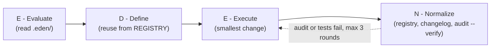

# E.D.E.N. Protocol
### Agent Operating System & Sovereign Engineering Harness
**Necessity Labs · Local-First · Zero-Bloat · Provider-Agnostic**

```
   ███████╗    ██████╗     ███████╗    ███╗   ██╗
   ██╔════╝    ██╔══██╗    ██╔════╝    ████╗  ██║
   █████╗      ██║  ██║    █████╗      ██╔██╗ ██║
   ██╔══╝      ██║  ██║    ██╔══╝      ██║╚██╗██║
   ███████╗    ██████╔╝    ███████╗    ██║ ╚████║
   ╚══════╝    ╚═════╝     ╚══════╝    ╚═╝  ╚═══╝
```

---

## 1. What is E.D.E.N.?

Modern autonomous AI coding agents (Claude Code, Cursor, GitHub Copilot, Gemini CLI / Antigravity, Windsurf, Aider) are extraordinarily capable, but when left unconstrained across multi-turn sessions they suffer from predictable failure modes:

1. **Cognitive Drift & Amnesia:** Agents forget previous architectural decisions, reinvent existing helpers, and introduce conflicting conventions.
2. **Utility Duplication:** Agents generate duplicate HTTP clients, file readers, string formatters, or database wrappers rather than discovering existing codebase primitives.
3. **Hardware & Ceiling Ignorance:** Cloud-trained models write code that assumes infinite RAM and unconstrained CPU, triggering Out-Of-Memory (OOM) crashes and thermal throttling on edge devices.
4. **Documentation Rot:** Agents modify business logic and source files while abandoning documentation, breaking handoffs to future sessions and human collaborators.

Passive prompt instructions fail to prevent this because prompts degrade as context windows fill.

The **E.D.E.N. Protocol** turns passive instructions into an **active, state-driven filesystem harness**. Built on plain Markdown, JSONL, and zero-dependency audit scripts, E.D.E.N. routes agents through a lane-based execution loop that mechanically prevents drift and duplication.

---

## 2. The Law of Necessity

Every AI agent operating in an E.D.E.N.-governed repository must adhere strictly to the **Law of Necessity**:

* **E — Everything is broken:** Assume zero-trust defaults. Rely on local sovereignty and pure primitives rather than fragile cloud dependencies or bloated abstractions.
* **D — Define the mechanics:** Understand raw memory, I/O, native bindings, process limits, and hardware ceilings before touching code.
* **E — Engineer the architecture:** Build modular, decoupled, unidirectional systems with explicit seams.
* **N — Necessity dictates the output:** Zero dead code, zero duplicate utilities, zero unapproved packages.

---

## 3. The E.D.E.N. Execution Loop

`AGENTS.md` is short decision rules, not ceremony. Agents first pick a lane:

| Lane | Examples | What runs |
| :--- | :--- | :--- |
| Read-only | questions, reviews | read and answer; no Normalize |
| Trivial | typo, comment, docs-only | change + audit |
| Normal | code change inside the current design | full loop |
| Architectural | new boundary, dependency, schema, deletion | Evaluate + Define, write plan, **wait for approval** |



1. **Evaluate:** read `.eden/ARCHITECTURE.md`, `.eden/REGISTRY.md`, `.eden/LEARNINGS.md`, and the last 10 lines of `.eden/CHANGELOG_AGENT.jsonl`.
2. **Define:** check `.eden/PLAN.md`; search the registry and reuse or extend before adding helpers or packages.
3. **Execute:** smallest change that meets the acceptance criteria.
4. **Normalize:** register changed source files, append a changelog line listing them, record verified learnings, update the plan, and run `python3 scripts/eden-audit.py --verify`.

**Done** = tests / `.eden/verify` pass + audit passes + acceptance criteria met. After 3 failed fix rounds the agent stops and reports to a human. `AGENTS.md` also defines what happens when a request conflicts with `PLAN.md`, and a short never-do list.

---

## 4. Repository Structure

```text
my-project/
├── AGENTS.md                  # Master Agent Operating System & Architecture Rules
├── CLAUDE.md                  # Universal Forwarder Trampoline -> AGENTS.md
├── .cursorrules               # Universal Forwarder Trampoline -> AGENTS.md
├── .cursor/rules/eden.mdc     # Cursor Rules Trampoline
├── .windsurfrules             # Universal Forwarder Trampoline -> AGENTS.md
├── .github/
│   └── copilot-instructions.md# Copilot Trampoline -> AGENTS.md
├── GEMINI.md                  # Gemini / Antigravity Trampoline -> AGENTS.md
├── .eden/
│   ├── ARCHITECTURE.md        # Runtime, limits, data flow, invariants
│   ├── REGISTRY.md            # Anti-Duplication Component & Dependency Map
│   ├── PLAN.md                # Active sprint backlog & task acceptance criteria
│   ├── LEARNINGS.md           # Episodic memory of bugs, pitfalls, and fixes
│   ├── CHANGELOG_AGENT.jsonl  # Append-only machine-readable mutation history
│   └── verify / verify.py     # Optional: project test + lint commands run by audit --verify
├── scripts/
│   ├── eden-audit.py          # Zero-dependency compliance auditor
│   └── eden-index.py          # Zero-dependency AST/regex component indexer
└── docs/                      # Human & project documentation
```

The protocol repository itself also contains `templates/` (the `.eden/` starter files and the pre-commit hook copied by the init scripts) and `tests/` (stdlib `unittest` smoke tests).

---

## 5. Quickstart

### Bootstrapping a Repository
Clone this repository once, then run its bootstrapper from the root of the repository you want to govern (or pass that path):

**Linux / macOS / Termux / PRoot / WSL:**
```bash
/path/to/E.D.E.N-Protocol/init-eden.sh [--force] [--name NAME] [TARGET_DIR]
```

**Windows PowerShell:**
```powershell
C:\path\to\E.D.E.N-Protocol\init-eden.ps1 [-Force] [-ProjectName NAME] [TargetDir]
```

The bootstrapper (target defaults to the current directory):
1. Copies `AGENTS.md` and the pointer files for Claude Code, Cursor, Copilot, Gemini/Antigravity, and Windsurf (byte-for-byte; no drift).
2. Copies `scripts/eden-audit.py` and `scripts/eden-index.py`.
3. Creates `.eden/` from `templates/eden/` and starts `.eden/CHANGELOG_AGENT.jsonl`.
4. Installs the pre-commit hook (`eden-audit.py --staged`).
5. Runs `eden-index.py` to index existing source files.

Existing files are never overwritten unless you pass `--force` / `-Force`; replaced files are kept as `<file>.eden-bak`, and existing `.eden/` state is always kept. Set `EDEN_RAW_BASE` to a raw-file URL of this repository to download the files instead of using a local clone.

Then fill in the `Commands` section of `AGENTS.md` and `.eden/ARCHITECTURE.md`, and optionally add `.eden/verify` with your test and lint commands.

### Verifying Compliance
```bash
python3 scripts/eden-audit.py                  # working tree, including new untracked folders
python3 scripts/eden-audit.py --staged         # what the pre-commit hook runs
python3 scripts/eden-audit.py --base origin/main --verify   # CI
```

### Testing this repository
```bash
python3 -m unittest discover -s tests          # or: python3 scripts/eden-audit.py --verify
```

---

## 6. Documentation Suite

* [**Protocol Specification**](docs/SPECIFICATION.md) — Complete specification of the `.eden/` control plane, JSONL schemas, and lifecycle rules.
* [**Multi-Agent Routing**](docs/MULTI_AGENT_ROUTING.md) — How forwarder trampolines ensure zero-drift execution across Claude, Cursor, Copilot, Gemini, and Windsurf.
* [**CLI & Compliance Auditing**](docs/CLI_AND_AUDITING.md) — Reference for `eden-audit.py`, `eden-index.py`, Git hooks, and CI/CD integration.
* [**Migration & Retrofit Guide**](docs/MIGRATION_GUIDE.md) — How to clean up existing doc sprawl and migrate legacy codebases to E.D.E.N.

---

## 7. License

Licensed under the MIT License. Built with sovereign discipline by **Necessity Labs**.
