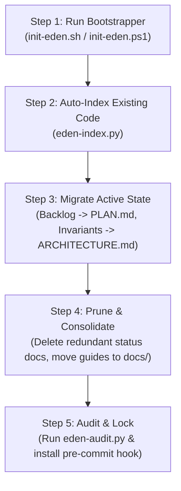

# E.D.E.N. Protocol Migration & Retrofit Guide
**Step-by-Step Modernization for Existing Repositories · Necessity Labs**

---

## 1. Why Retrofit Existing Projects?

Most active software repositories accumulate documentation sprawl over time:
- Inconsistent notes scattered across root markdown files (`NEXT-STEPS.md`, `PROJECT_STATUS.md`, `TODO.md`, `SETUP.md`).
- Multi-hundred-line agent instruction files that exceed context budgets.
- AI agents creating duplicate utilities because they lack a centralized, lightweight index of existing code.

Retrofitting a codebase with E.D.E.N. Protocol replaces this chaotic sprawl with a clean, unified, multi-agent control plane.

---

## 2. 5-Step Migration Procedure



### Step 1: Run the Bootstrapper
Run the scaffolder inside the root of your existing repository:

**Linux / macOS / Termux:**
```bash
./init-eden.sh
```

**Windows PowerShell:**
```powershell
.\init-eden.ps1
```

This creates:
- The `.eden/` control plane (`ARCHITECTURE.md`, `REGISTRY.md`, `PLAN.md`, `LEARNINGS.md`, `CHANGELOG_AGENT.jsonl`).
- The `scripts/` directory with `eden-audit.py` and `eden-index.py`.
- Universal forwarder trampolines (`CLAUDE.md`, `.cursorrules`, `.cursor/rules/eden.mdc`, `.github/copilot-instructions.md`, `GEMINI.md`, `.windsurfrules`).
- The `.git/hooks/pre-commit` hook.

### Step 2: Auto-Index the Codebase
Generate the initial index of your internal modules, classes, and exported APIs:
```bash
python scripts/eden-index.py .
```
Verify that `.eden/REGISTRY.md` now lists your core modules in Section 2. Add any known `BANNED:` packages to Section 1.

### Step 3: Migrate Active Tasks & Invariants
1. **Backlogs & Roadmaps:** Move in-flight tasks and sprint items from legacy files (`NEXT-STEPS.md`, `TODO.md`) into `.eden/PLAN.md`.
2. **Hardware & Environment Boundaries:** Move memory ceilings, runtime constraints, toolchain notes, and data flow from legacy status documents into `.eden/ARCHITECTURE.md`.
3. **Past Pitfalls & Quirks:** Move troubleshooting tips and resolved environment bugs into `.eden/LEARNINGS.md`.

### Step 4: Prune Redundant Documents
1. **Delete Dead Status Files:** Once backlog and architecture have been absorbed into `.eden/`, delete legacy files like `PROJECT_STATUS.md` and `NEXT-STEPS.md`.
2. **Organize Guides:** Move standalone setup or design docs into categorized subdirectories in `docs/` (e.g. `docs/setup/`, `docs/hardware/`, `docs/design/`).
3. **Keep Root Clean:** Keep only `README.md`, `LICENSE`, `AGENTS.md`, and the universal forwarder trampolines in the root folder.

### Step 5: Verify Compliance
Record the migration in the agent mutation log:
```json
{"timestamp": "2026-10-27T16:00:00Z", "phase": "Normalize", "task_id": "EDEN-MIGRATION", "action": "REFACTORED", "files": ["AGENTS.md", ".eden/*"], "reused_modules": [], "summary": "Migrated repository to E.D.E.N. Protocol control plane."}
```
Run the compliance auditor:
```bash
python scripts/eden-audit.py
```
When it exits with `0`, your repository is fully compliant and ready for autonomous agent development.
