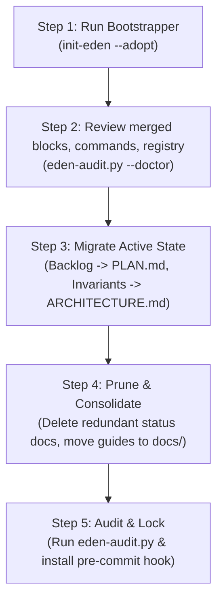

# E.D.E.N. Protocol Migration & Retrofit Guide
**Step-by-Step Modernization for Existing Repositories · Necessity Labs**

---

## 1. Why Retrofit Existing Projects?

Most active software repositories accumulate documentation sprawl over time:
- Inconsistent notes scattered across root markdown files (`NEXT-STEPS.md`, `PROJECT_STATUS.md`, `TODO.md`, `SETUP.md`).
- Multi-hundred-line agent instruction files that exceed context budgets.
- AI agents creating duplicate utilities because they lack a centralized, lightweight index of existing code.

Retrofitting a codebase with E.D.E.N. Protocol replaces this chaotic sprawl with a clean, unified, multi-agent control plane.

---

## 2. 5-Step Migration Procedure



### Step 1: Run the Bootstrapper in adopt mode
Clone the protocol repository somewhere outside your project, then run its bootstrapper from the root of your existing repository (or pass the repository path). A repository with commits or source files is adopted automatically; `--adopt` / `-Adopt` makes it explicit:

**Linux / macOS / Termux / Git Bash:**
```bash
/path/to/E.D.E.N.-Protocol/init-eden.sh --adopt            # current directory
/path/to/E.D.E.N.-Protocol/init-eden.sh --adopt ~/src/app  # explicit target
```

**Windows PowerShell:**
```powershell
C:\src\E.D.E.N.-Protocol\init-eden.ps1 -Adopt             # current directory
C:\src\E.D.E.N.-Protocol\init-eden.ps1 -Adopt C:\src\app
```

Adopt mode:
- **Merges instead of skipping.** An existing `AGENTS.md`, `CLAUDE.md`, `GEMINI.md`, or `.github/copilot-instructions.md` keeps its text; E.D.E.N. appends one block between `<!-- EDEN:BEGIN v1 -->` and `<!-- EDEN:END -->` (headings demoted under `## E.D.E.N. Protocol`, line endings preserved). Re-runs update only that block. Edit outside the markers freely; edits inside are replaced on the next run.
- **Merges hook configs.** An existing `.cursor/hooks.json`, `.github/hooks/eden.json`, or `.agents/hooks.json` gains the E.D.E.N. stop hook once; your other hooks stay. Unparseable files are skipped with a message.
- **Detects commands.** Setup/Build/Test/Lint are read from `Makefile` targets, `package.json` scripts (package manager from the lockfile), `pyproject.toml` (uv, Poetry, or pip; pytest, ruff), `Cargo.toml`, `go.mod`, and `gradlew`. They fill the Commands section of `AGENTS.md`, and `.eden/verify` (lint, then test) is created if you do not have one. Check them: detection is a starting point. Use `--no-detect` to skip it.
- **Indexes existing code** into `.eden/REGISTRY.md` when the registry is created (or with `--reindex`).
- **Respects hook managers.** With husky, lefthook, or pre-commit present, the git hook is not installed; add `python3 scripts/eden-audit.py --staged` to your manager's pre-commit step (a full integration is not automated yet).
- **Logs what it did.** The first changelog line is `EDEN-ADOPT` and lists only the files written or merged.

A full E.D.E.N. `AGENTS.md` from an earlier install that you have edited is kept as-is. `--force` / `-Force` replaces managed files wholesale (each kept as `<file>.eden-bak`); `.eden/` state is never replaced. `--tools` limits the tool files (default `antigravity,cursor,grok,vscode`); `--legacy` adds `.cursorrules` and `.windsurfrules`.

### Step 2: Review the generated state
Run `python3 scripts/eden-audit.py --doctor` to see what each tool loads and what is unfinished. Check that `.eden/REGISTRY.md` section 2 lists your core modules, and add any known `BANNED:` packages to section 1. Your agent can do the rest of this guide with the `eden-adopt` skill in `.agents/skills/`.

### Step 3: Migrate Active Tasks & Invariants
1. **Backlogs & Roadmaps:** Move in-flight tasks and sprint items from legacy files (`NEXT-STEPS.md`, `TODO.md`) into `.eden/PLAN.md`.
2. **Hardware & Environment Boundaries:** Move memory ceilings, runtime constraints, toolchain notes, and data flow from legacy status documents into `.eden/ARCHITECTURE.md`.
3. **Past Pitfalls & Quirks:** Move troubleshooting tips and resolved environment bugs into `.eden/LEARNINGS.md`.

### Step 4: Prune Redundant Documents
1. **Delete Dead Status Files:** Once backlog and architecture have been absorbed into `.eden/`, delete legacy files like `PROJECT_STATUS.md` and `NEXT-STEPS.md`.
2. **Organize Guides:** Move standalone setup or design docs into categorized subdirectories in `docs/` (e.g. `docs/setup/`, `docs/hardware/`, `docs/design/`).
3. **Keep Root Clean:** Keep only `README.md`, `LICENSE`, `AGENTS.md`, and the pointer files in the root folder.

### Step 5: Verify Compliance
The bootstrapper already logged an `EDEN-ADOPT` line. Record your manual migration work in one more line:
```json
{"timestamp": "2026-10-27T16:00:00Z", "phase": "Normalize", "task_id": "EDEN-MIGRATION", "action": "REFACTORED", "files": [".eden/ARCHITECTURE.md", ".eden/PLAN.md", ".eden/REGISTRY.md"], "reused_modules": [], "summary": "Migrated repository state into the E.D.E.N. control plane."}
```
Confirm the detected Commands and `.eden/verify`, then run the compliance auditor:
```bash
python3 scripts/eden-audit.py --verify
```
When it exits with `0`, your repository is fully compliant and ready for autonomous agent development.
